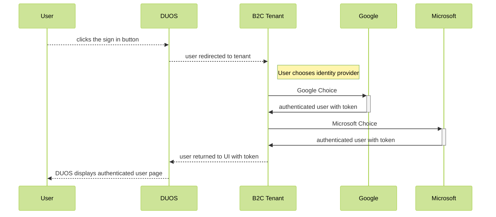
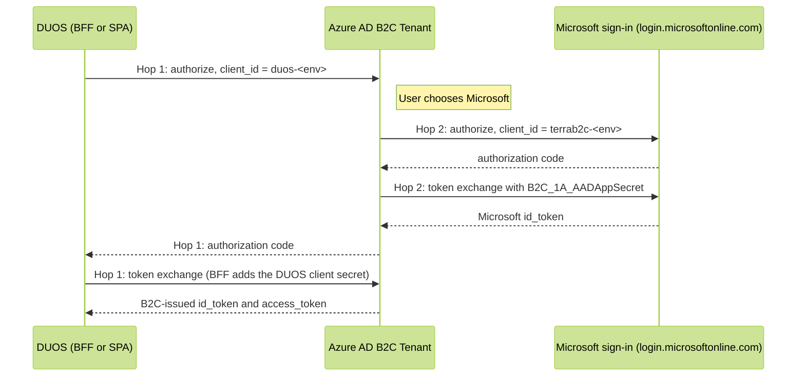
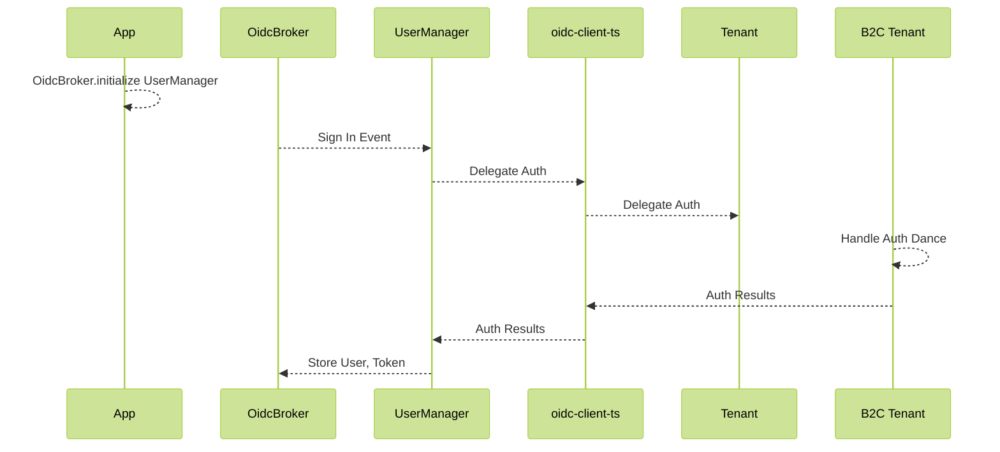
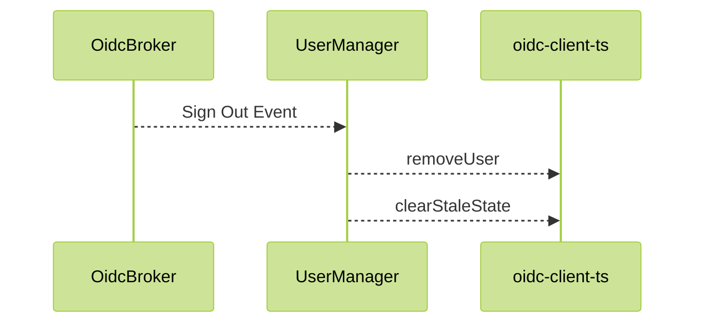
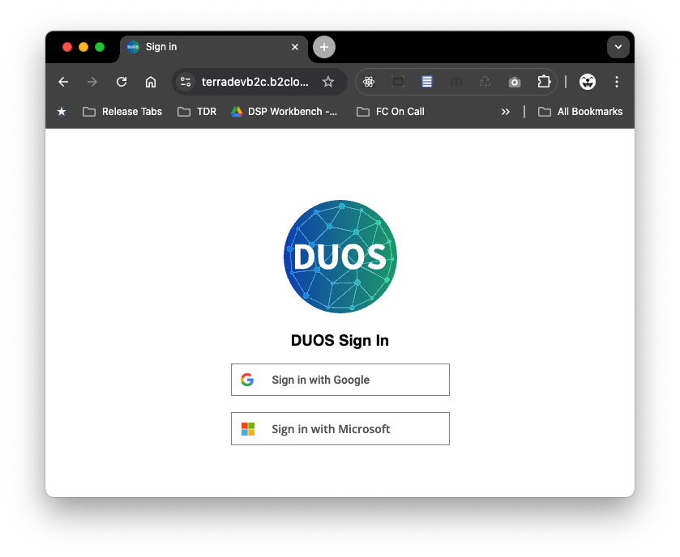
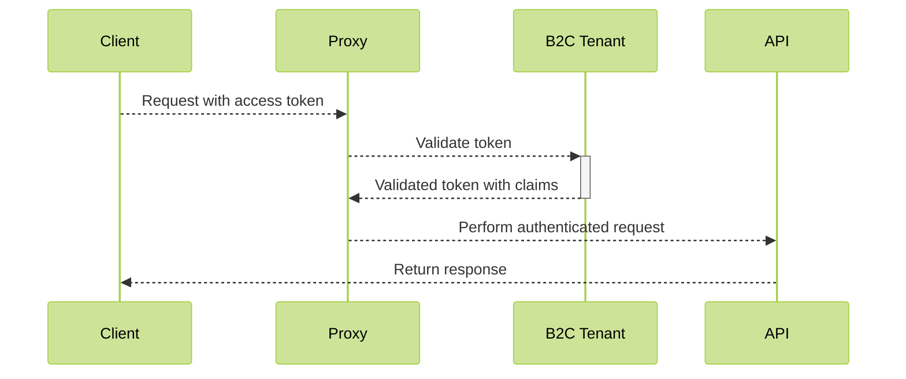

## DUOS B2C Authentication Overview

> **This document describes the LEGACY client-side flow** (`oidc-client-ts`,
> tokens in browser `localStorage`). DUOS is migrating to the Backend For
> Frontend (BFF) pattern, where the server owns the OAuth flow and the browser
> holds only a session cookie — see
> [plans/BFF_Overview.md](plans/BFF_Overview.md). Each deployment runs the
> flow that its `config.json` `bffEnabled` flag selects; the legacy flow
> below is removed in BFF Phase 6.

DUOS' implementation of B2C authentication follows a similar pattern that
Terra has adopted. In short, we use OIDC libraries to direct a user to a
DSP-specific B2C tenant. That tenant offers up two ways of providing an
identity, Google or Microsoft. Choosing one directs the user to either a
Google or Microsoft authentication verification screen. Once authenticated,
the user is redirected back to the application with a valid token that can
be used for all back-end API calls.

## Table of Contents
* [UI Auth Flow](#UI-Auth-Flow)
* [B2C Federation: Two OAuth Hops](#B2C-Federation-Two-OAuth-Hops)
* [OIDC Mechanics](#OIDC-Mechanics)
* [DSP's B2C Tenant Choices](#DSP's-B2C-Tenant-Choices)
* [Server Auth Flow](#Server-Auth-Flow)

### UI Auth Flow

* User: Any Google or Microsoft identity such as a real person, or a service account of some kind
* DUOS: The DUOS Application
* B2C: The DSP proxy that proxies authentication through either Google or Microsoft
* Google: If a user chooses Google, a Google identity is expected
* Microsoft: If a user chooses Microsoft, a Microsoft identity is expected

### B2C Federation: Two OAuth Hops

This section applies to both the legacy flow and the BFF flow.

A sign-in is two separate OAuth exchanges, each with its own client and its
own credential. DUOS is the client only in the first one. In the second, the
B2C tenant is itself an OAuth client of Google or Microsoft.

| Hop | Client | Credential | Owner |
|-----|--------|------------|-------|
| 1. DUOS → B2C | DUOS app registration (`duos-<env>`) | DUOS client secret (BFF) | DUOS |
| 2. B2C → Microsoft | Shared Terra registration (`terrab2c-<env>`) | B2C policy key `B2C_1A_AADAppSecret` | Shared Terra platform |
| 2. B2C → Google | Google OAuth client for the environment | B2C policy key `B2C_1A_GoogleSecret<Env>` | Shared Terra platform |

The DUOS custom policy (`TrustFrameworkExtensionsDUOS.xml.tftpl` in
terraform-ap-deployments) names the hop 2 client ID and policy key. A change
to the DUOS app registration has no effect on hop 2.

Hop 2 goes to Microsoft's own sign-in service. It accepts work and school
accounts (Microsoft Entra ID, formerly Azure AD) and personal Microsoft
accounts. This is not Entra External ID; DUOS still uses Azure AD B2C.

The Google path has the same shape, with the Google OAuth client and its
policy key in hop 2.

A failure in hop 2 reaches DUOS only as an error on the hop 1 callback. For
example, an expired hop 2 secret makes B2C return `error=server_error` with
`AADB2C90289` (`invalid_client` from the identity provider). The BFF shows the
generic "identity provider reported an error" message. The fix is in the B2C
tenant (rotate the secret and upload a new version of the policy key), not in
DUOS.

### OIDC Mechanics

DUOS uses the [oidc-client-ts](https://github.com/authts/oidc-client-ts) library
to facilitate user authentication through either Google or Microsoft. Once authenticated,
the library provides DUOS with user information about the authenticated identity and an 
access token that can be verified/validated in a proxy layer that sits in front of each
service DUOS communicates with.

DSP's tenant requests claims that are [configured here](https://github.com/broadinstitute/terraform-ap-deployments/blob/master/azure/b2c/policies/SignUpOrSignin.xml.tftpl).
Once authenticated, the DUOS application will use the `oidc-client-ts` library to access
an identity's `access_token` and make API calls using it. All downstream API servers are
expected to validate that token against the same B2C tenant.

DUOS' implementation instantiates an OIDC library [UserManager](https://authts.github.io/oidc-client-ts/classes/UserManager.html)
that handles most of our authentication logic. `UserManager` is instantiated with configuration values
that come from open (and intentionally undocumented) server side APIs:
* Authorization Endpoint: https://consent.dsde-prod.broadinstitute.org/oauth2/authorize
* Token Endpoint: https://consent.dsde-prod.broadinstitute.org/oauth2/token

These endpoints return configuration information specific to DSP's custom tenant. From there, 
we use `OidcBroker` functions to instantiate a [User](https://authts.github.io/oidc-client-ts/classes/User.html),
which we extend as a `OidcUser` and tack on a set of `B2cIdTokenClaims` that extends [IdTokenClaims](https://authts.github.io/oidc-client-ts/interfaces/IdTokenClaims.html).

#### Sign In Case

#### Sign Out Case

### DSP's B2C Tenant

DSP maintains resources in Azure that allow for a customized tenant in
https://github.com/broadinstitute/terraform-ap-deployments/tree/master/azure/b2c

* In `assets`, there is a unified_simple.html file that serves as a template for a sign-in page
* In `policies`, there is a `TrustFrameworkBase.xml.tftpl` that references that template 
* In `policies`, there is a `TrustFrameworkBaseExtension.xml.tftpl` that references that TrustFrameworkBase
* In `policies`, there is a `SignUpOrSignin.xml.tftpl` that references that TrustFrameworkExtension

For DUOS, we have custom versions of each that have new profile name, `B2C_1A_signup_signin_duos_<env>`.
The profile name is used as a parameter to the OIDC tenant. The UI the tenant shows is based on
that profile name.

### Server Auth Flow

Back-end servers are each configured with a proxy that can verify a token
from any of the identity providers configured in our B2C tenant. The proxy
tacks on a list of extra headers that services can use:
* OAUTH2_CLAIM_email
* OAUTH2_CLAIM_name
* OAUTH2_CLAIM_access_token
* OAUTH2_CLAIM_aud

